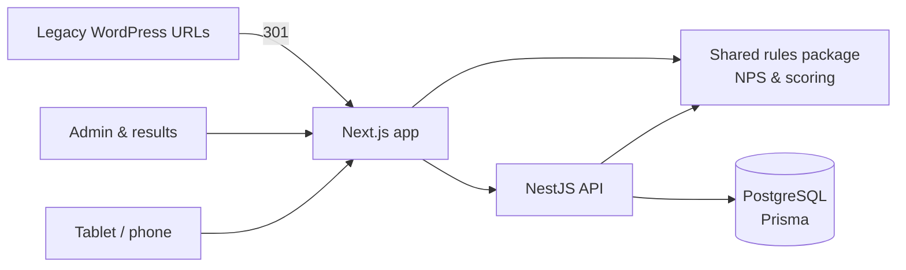

# NPS & Guest Feedback Platform: Case Study

> Feedback platform I built for **Vale Verde Festas** to collect NPS from guests at events (tablet + QR codes) and from clients after the event, replacing three legacy WordPress pages.
> **Source code is private.** This repository documents the project; a live walkthrough is available on request.

## The problem

Guest and client feedback lived in three WordPress pages built with custom PHP shortcodes: hard to change, with bugs in the exports (unanswered scores exported as -1/0) and a weak experience on the tablets used at events.

## What I built

| Screen | Purpose |
|---|---|
| **Event tablet** | Pick the date and event from the calendar, then the guest; generates a personal QR code or lets the guest answer right there |
| **Post-event survey** | Link sent to the client after the event |
| **Results** | Filters, cards, distributions, histograms, comparisons, Excel/CSV export |
| **Admin** | Events from the calendar, a unique QR code per event (generate, print, download, rotate) and VIP guest lists |

- **Tablet-first UX**: one question per screen with no scrolling at four tablet sizes (portrait and landscape), large touch targets, nothing depends on hover or keyboard, keyboard-aware layout on iOS and Android.
- **Google review invitation** for promoters (NPS 9–10), shown as a QR code on the tablet.
- **Anti-bot rate limits** per device and global, Argon2-hashed passwords, a separate **read-only role** for the sales team.
- **Shared rules package**: the scoring and NPS calculations live in one package used by both the API and the web app, so numbers never diverge.

## Migration from WordPress

- Reverse-engineered the legacy PHP (every field, rule and calculation documented with line references).
- SQL export of historical answers, **fixed the legacy export bugs**, and a planned cut-over on a morning with no events.
- Old URLs answer with **301 redirects (query string preserved)** to the new domain, so printed QR codes and sent links keep working.

## Architecture

- ~26k lines of TypeScript, 55+ test files.

## My role

Analysis of the legacy system, product decisions, architecture, full stack development, migration plan and cut-over.

---
Built by **Victor Sestrem** · [LinkedIn](https://www.linkedin.com/in/victor-sestrem/) · victor-sestrem@hotmail.com
